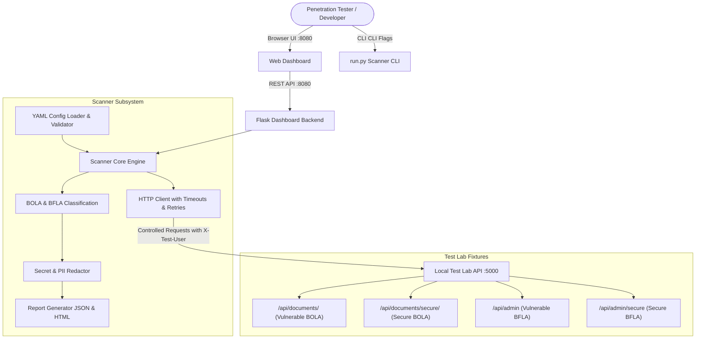

# Architecture & System Design

## 1. Overview
The Automated API Authorization Security Testing Framework is designed to detect **Broken Object Level Authorization (BOLA)** and **Broken Function Level Authorization (BFLA)** vulnerabilities in REST APIs.

The system consists of three primary subsystems:
1. **Local Test Lab (`app/api.py`)**: A controlled, intentionally vulnerable and secure API server running strictly on `127.0.0.1:5000`.
2. **Scanner Engine (`app/scanner.py`, `app/authorization_checks.py`, `app/config.py`)**: Reusable scanning core that executes controlled identity requests, performs comparative response analysis, enforces host allowlists, and extracts evidence.
3. **Dashboard & Reporting (`app/routes.py`, `app/report_generator.py`, `dashboard/`)**: A dark-mode cybersecurity dashboard with REST endpoints, real-time status polling, interactive findings inspection, and atomic JSON/HTML report generation.

---

## 2. Core Architecture Diagram

---

## 3. Threat Model & Security Controls

- **Localhost Bound**: Defaults strictly to `127.0.0.1`.
- **Target Allowlist**: Rejects any non-allowlisted targets before issuing requests.
- **Scheme Validation**: Strictly restricts protocols to `http` and `https`.
- **Secret Redaction**: Redacts fields matching `password`, `token`, `secret`, `api_key` before writing reports or rendering UI.
- **Fail-Safe Classification**: Connection timeouts or refused connections are strictly classified as `ERROR` or `FAILED`, never false-clean `NOT DETECTED`.
